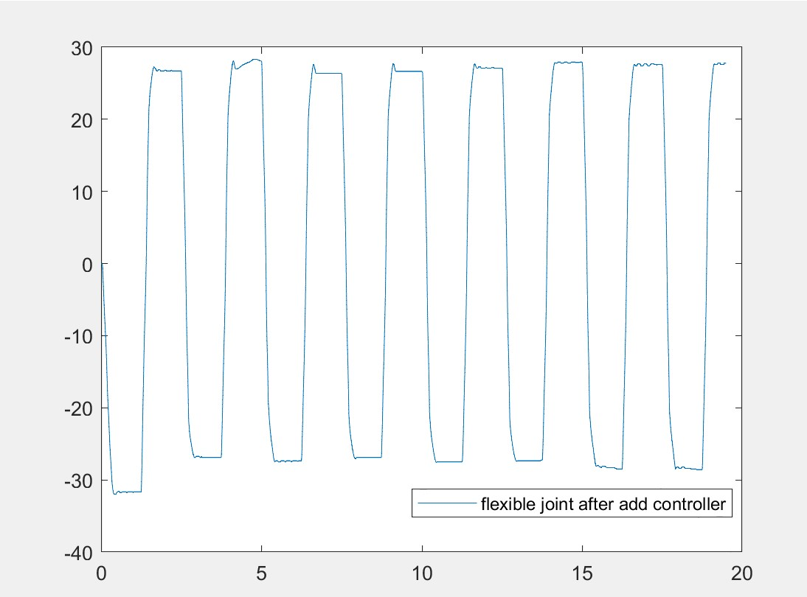

# Flexible-Joint Robotic Control

**Modeling and feedback-controller design for a DC-motor-actuated flexible-joint robotic system** using MATLAB and Simulink.

This repository brings together four related experiments: **lead compensation**, **lag compensation**, **lead–lag compensation**, and **state-feedback pole placement**. It includes the original analysis scripts, Simulink models, saved MATLAB data/figures, report PDFs, and LaTeX source.

> **Scope:** This is about controlling joint motion in a *flexible-joint robotic system*. A DC motor provides the actuator torque, but this is not simply a stand-alone DC motor speed-control project. Ball-and-beam material is deliberately excluded.

## Control methods

| Experiment | MATLAB source | Simulink | Report |
| --- | --- | --- | --- |
| Lead compensation | [`matlab/lead/Matrix_Lead.m`](matlab/lead/Matrix_Lead.m) | [`Lead.slx`](matlab/lead/Lead.slx) | [Report 5](reports/report_05_lead.pdf) |
| Lag compensation | [`matlab/lag/Matrix_Lag.m`](matlab/lag/Matrix_Lag.m) | [`Lag.slx`](matlab/lag/Lag.slx) | [Report 6](reports/report_06_lag.pdf) |
| Lead–lag compensation | [`matlab/lead_lag/Matrix_Lead.m`](matlab/lead_lag/Matrix_Lead.m) | Not supplied for this experiment | [Report 7](reports/report_07_lead_lag.pdf) |
| State feedback | [`matlab/state_feedback/M8.m`](matlab/state_feedback/M8.m) | [`simulin8.slx`](matlab/state_feedback/simulin8.slx) | [Report 8](reports/report_08_state_feedback.pdf) |

The original symbolic derivation is in [`matlab/modeling/Equation_Solve.m`](matlab/modeling/Equation_Solve.m). The source originally contained three byte-identical copies; one unchanged copy is retained here.

## System model

The model couples the motor/gear equivalent inertia and damping with a torsionally flexible robotic joint. The state vector used in the supplied reports is:

\[
 x = [\theta,\ \dot\theta,\ \alpha,\ \dot\alpha]^\top
\]

Here, `θ` is the motor-side angular coordinate and `α` represents relative joint deflection. The supplied scripts use a four-state system, with motor voltage as the input and the first state as the modeled output. See [model details](docs/MODEL.md).

## Results already present

The reports and files include original Bode/margin plots, step-response plots, saved MATLAB figures, and Simulink diagrams. For example, the original lead–lag report contains a saved flexible-joint response:



**These are archived results, not simulations rerun for this repository.** See [experiments](docs/EXPERIMENTS.md) and [verification limits](docs/REPRODUCIBILITY.md).

## Getting started

Requirements: **MATLAB**, **Control System Toolbox**, **Simulink**; **Symbolic Math Toolbox** is required for the symbolic derivation script. Other installed model-block dependencies may also be required by the original Simulink models.

From the repository root, run one experiment at a time in MATLAB:

```matlab
run('matlab/modeling/Equation_Solve.m');       % Symbolic Math Toolbox
run('matlab/lead/Matrix_Lead.m');             % lead design
run('matlab/lag/Matrix_Lag.m');               % lag design
run('matlab/lead_lag/Matrix_Lead.m');         % combined lead–lag
run('matlab/state_feedback/M8.m');            % pole placement
```

The original scripts use workspace clearing commands and are intended to be executed **separately**. To inspect model diagrams, open the `.slx` files in their original subdirectories. The models have not been executed on the user's MATLAB installation in this packaging pass.

## Repository layout

```text
matlab/
  modeling/          Shared symbolic flexible-joint dynamics
  lead/              Lead controller and Simulink model
  lag/               Lag controller, model and saved data
  lead_lag/          Combined compensation and saved figures
  state_feedback/    Pole-placement controller and Simulink model
reports/
  report_05_lead.pdf ... report_08_state_feedback.pdf
  latex/report_*/    Original LaTeX and figure assets
scripts/             Static archive/source checks (no MATLAB required)
tests/               File-structure integrity tests
```

All original report sources and figures are retained with correct relative paths. Generated LaTeX `.aux`, `.log` and `.synctex.gz` files are excluded.

## Credits and limitations

See [CREDITS.md](CREDITS.md) and [source provenance](docs/PROVENANCE.md). No new controller design, experimental performance, or hardware test is claimed here. All underlying research material is preserved with its original attribution. No repository-wide license was supplied.
